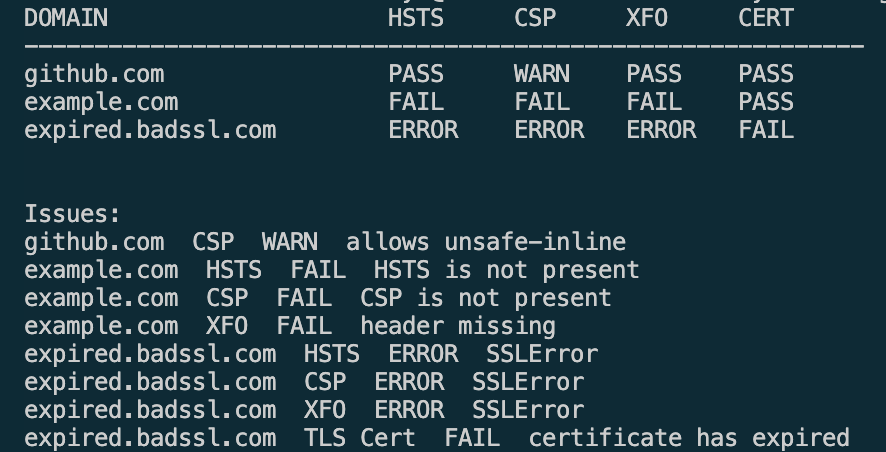

# Python Domain Security Scanner

## What does this tool do?

This tool is a domain security scanner. When given a list of domains, it checks and reports whether each site sends the important HTTP security headers and how long until its TLS Certificate expires. It then outputs every check into a table with the header's assigned status, followed by an Issues list shows what didn’t pass. Results can be exported to JSON/CSV.

## What is being checked for?
**HSTS (Strict-Transport-Security):**
- HSTS is a web security policy that forces browsers to connect with a website using only secure HTTPS connections.
- This is important because this prevents man-in-the-middle (MITM) attacks, SSL stripping, protocol downgrade attacks, and cookie hijacking.
- The scanner checks whether or not the `max-age` setting is greater than 1 year.
- If `max-age` is greater than 1 year then HSTS is graded as `PASS`
if `max-age` is missing it is graded as `FAIL`

**CSP (Content-Security-Policy):**
- CSP is a web security policy that protects websites from Cross-Site Scripting (XSS). It controls where scripts, styles and frames can load from.
- The scanner checks whether or not CSP is present and whether or not it contains `unsafe-inline` or `unsafe-eval`.

**X-Frame-Options:**
- X-Frame Options determines whether a browser can embed a webpage inside an iframe. It stops clickjacking, where another site embeds yours in a hidden iframe.
- The scanner checks X-Frame Options contains `DENY` or `SAMEORIGIN`

**TLS Certificate:**
- A TLS Certificate is a document that verifies the identity of a website and enables encrypted communication through the HTTPS protocol.
- The scanner checks how long until expiry the certificate has.

## Grading Rules
**PASS:** 
**WARN:**
**FAIL:**
**ERROR:**

## Real-world Use


## Installation

Requires Python 3 (tested on 3.14).

```
git clone https://github.com/michaeladeboye/domain-scanner.git
cd domain-scanner
python3 -m venv .venv
source .venv/bin/activate        # Windows: .venv\Scripts\activate
pip install -r requirements.txt
```

## Usage

Create a text file with one domain per line (no `https://`):

```
github.com
example.com
notarealsite12345.com
```

Run a scan:

```
python scanner.py domains.txt
```

Export results:

```
python scanner.py domains.txt --json results.json --csv results.csv
```

Exit code is `0` if nothing FAILs or ERRORs and `1` otherwise, so the scanner
can be used in scheduled jobs or CI pipelines.

## Example Output



